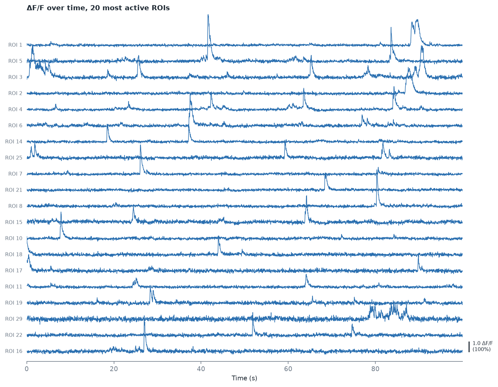

# calcium-imaging

A small Python pipeline that takes a raw calcium imaging movie, finds active cells with
computer vision, and outputs each cell's ΔF/F (relative fluorescence change) over time.

It is written from scratch on NumPy, SciPy, scikit-image and OpenCV, so every step is short
enough to read and adjust. It does not depend on Suite2p or CaImAn.



## What it does

```
raw movie (TIFF)
   │  load, subtract dark offset
   ▼
motion correction      rigid, sub-pixel phase correlation
   ▼
cell detection         local-correlation image → band-pass → threshold → watershed
   ▼
trace extraction       mean fluorescence per cell, neuropil-corrected
   ▼
ΔF/F                   (F − F0) / F0, with F0 a running low percentile
   ▼
outputs/               dff.csv, dff.npz, four figures
```

On the bundled demo dataset (3000 frames, 170×170 px, 100 s) the full run takes about
4 seconds and finds 31 cells.

## Quick start

Requires [uv](https://docs.astral.sh/uv/) (or any other way to make a Python ≥ 3.10
virtual environment).

```bash
# 1. Environment
uv venv --python 3.12 .venv
uv pip install --python .venv/bin/python -e ".[dev]"

# 2. Demo data (347 MB, saved to data/raw/)
.venv/bin/calcium-dff download

# 3. Run
.venv/bin/calcium-dff run data/raw/Sue_2x_3000_40_-46.tif --fps 30
```

Results are written to `outputs/`:

| File | Contents |
|---|---|
| `dff.csv` | `time_s` column plus one ΔF/F column per cell (`roi_1`, `roi_2`, …) |
| `dff.npz` | ΔF/F, baselines, raw and neuropil traces, cell masks, motion shifts, summary images |
| `dff_traces.png` | ΔF/F vs time for the 20 most active cells |
| `dff_heatmap.png` | ΔF/F for every cell |
| `rois.png` | Summary images with the detected cell outlines |
| `motion.png` | Estimated x/y shift of every frame |

## Documentation

| Document | Read it for |
|---|---|
| [docs/usage.md](docs/usage.md) | Command-line reference, running on your own movie, tuning, Python API |
| [docs/pipeline.md](docs/pipeline.md) | How each stage works, its parameters, and why it is done that way |
| [docs/outputs.md](docs/outputs.md) | Exact format of every output file and how to load them |
| [docs/development.md](docs/development.md) | Code layout, tests, and how to change or extend the pipeline |

## Demo dataset

`Sue_2x_3000_40_-46.tif` is a two-photon recording of GCaMP6f-expressing neurons in mouse
cortex: 3000 frames at about 30 Hz, 170×170 pixels. It is distributed with
[CaImAn](https://github.com/flatironinstitute/CaImAn) (Giovannucci et al., *eLife* 2019) and
downloaded from
`https://caiman.flatironinstitute.org/~neuro/caiman_downloadables/Sue_2x_3000_40_-46.tif`.

The `data/` and `outputs/` folders are not tracked by git.

## Limitations

Read these before relying on the numbers.

- **Absolute ΔF/F values depend on two conventions.** The dark offset (the pixel value that
  means "no light") defaults to the movie minimum, which is an estimate. The neuropil
  correction removes neuropil fluctuations but keeps its median level, which gives smaller
  ΔF/F than subtracting the full neuropil signal. See
  [docs/pipeline.md](docs/pipeline.md#2-dark-offset).
- **Silent cells are missed.** Detection is based on activity, so a cell that never fires
  during the recording is not found.
- **Cells at the image border are discarded.**
- **Overlapping cells are not demixed.** Each pixel belongs to at most one cell.
- **Motion correction is rigid.** It handles whole-frame translation, not local warping or
  movement in depth.
- **Fast baseline drift is tracked with a lag** of about half the baseline window.
- **Cell detection has only been checked by eye** on the demo dataset, and by automated
  tests on synthetic movies. It has not been scored against hand-labelled ground truth.
