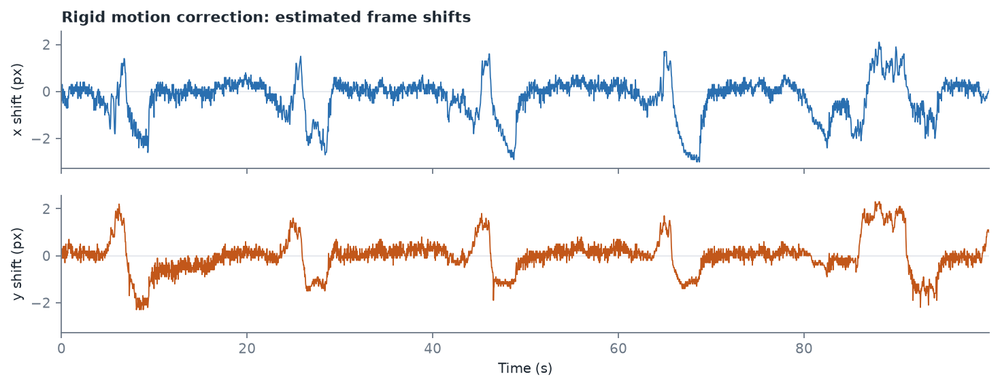
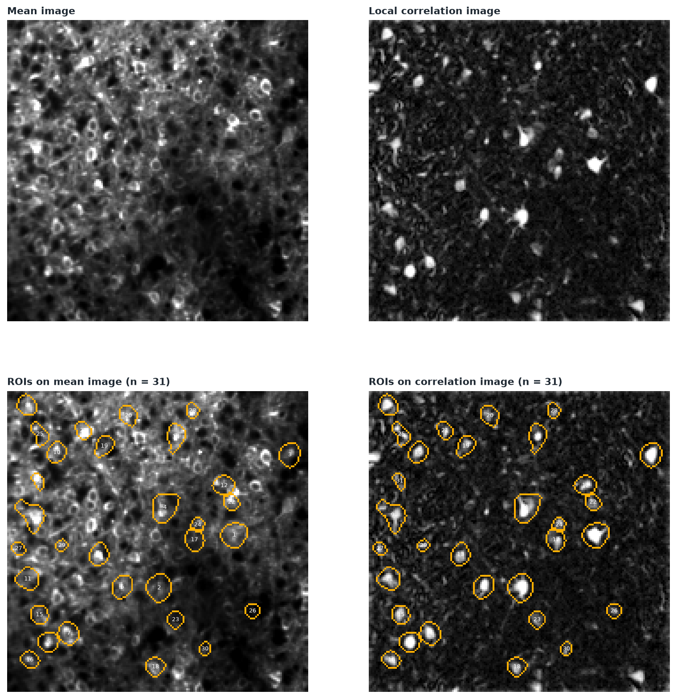
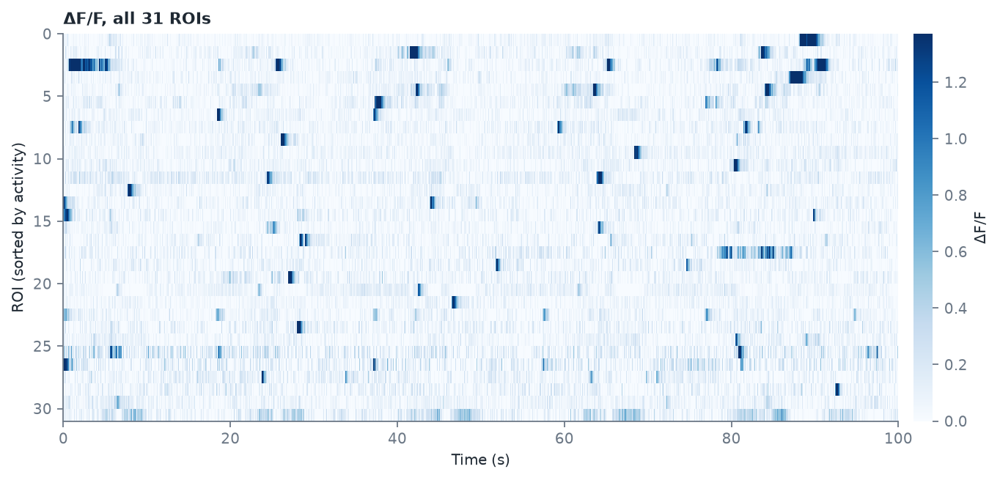

# How the pipeline works

This document walks through each stage in the order it runs: what it computes, the
parameters involved, and the reasoning behind the choices. Parameters marked *(CLI)* can be
set from the command line; the others are function arguments with the defaults shown.

Background, for readers new to the technique: neurons expressing a calcium indicator such as
GCaMP get brighter when they fire. A microscope records a movie of the tissue. The analysis
problem is to find the cells in that movie and turn each one's brightness into a trace that
is comparable across cells. The convention is **ΔF/F = (F − F0) / F0**, the fractional change
of fluorescence `F` relative to the cell's own resting level `F0`.

---

## 1. Load

`io.load_movie` · [src/calcium_imaging/io.py](../src/calcium_imaging/io.py)

Reads a TIFF stack with `tifffile`, drops singleton dimensions, and converts to 32-bit
floats with shape `(T, Y, X)`: frames, rows, columns. Anything that is not 3-D (for example
a two-channel recording) raises an error rather than being guessed at.

## 2. Dark offset

`cli.run_pipeline` · [src/calcium_imaging/cli.py](../src/calcium_imaging/cli.py)

| Parameter | Default |
|---|---|
| `dark_offset` *(CLI `--dark-offset`)* | movie minimum |

ΔF/F is a ratio, so it is only meaningful when a pixel value of zero means zero light.
Acquisition systems commonly add an arbitrary offset. The demo movie has values from −296 to
2118, with about 1 % of pixels sitting exactly at −296: a clipped floor. Without correction
most baselines are negative and the ratio is nonsense.

The pipeline subtracts one number from the whole movie before anything else. By default that
number is the darkest pixel in the movie.

**This is an estimate, and it scales every ΔF/F value.** If the true zero-light level is
higher than the movie minimum, baselines are overestimated and ΔF/F is underestimated, and
vice versa. If you know the offset of your detector (for example from a frame recorded with
the laser shuttered), pass it explicitly.

## 3. Motion correction

`motion.correct_motion` · [src/calcium_imaging/motion.py](../src/calcium_imaging/motion.py)

The brain moves under the microscope as the animal breathes and moves. If a cell drifts in
and out of its outline, its trace picks up false changes. This stage shifts every frame so
the tissue stays in place.

| Parameter | Default | Meaning |
|---|---|---|
| `n_iter` | 2 | Passes of estimate → apply → rebuild template |
| `upsample` | 10 | Sub-pixel precision: shifts are resolved to 1/10 pixel |
| `sigma` | 1.0 | Gaussian blur (pixels) applied before estimating shifts |
| `max_shift` | 15 % of the smaller image side | Shifts are clamped to this |

Steps:

1. **Template.** Take 200 evenly spaced frames, correlate every pair, and average the 40
   frames that agree best with the rest. These are frames where the tissue sat in its most
   common position, so the template is sharp rather than blurred by motion.
2. **Estimate shifts.** For each frame, find the `(dy, dx)` translation that best aligns it
   to the template using phase cross-correlation
   (`skimage.registration.phase_cross_correlation`). Frames are blurred slightly first so the
   estimate follows structure rather than pixel noise.
3. **Apply shifts.** Translate each frame with bilinear interpolation (`cv2.warpAffine`).
   Pixels shifted in from outside the image copy the nearest edge value.
4. **Refine.** Rebuild the template as the mean of the corrected movie and repeat once.
   Shifts are always estimated from the original frames, so each frame is interpolated only
   once.

Only whole-frame translation is corrected. Rotation, local stretching, and movement in depth
are not. On the demo movie, shifts reach 3 pixels and come in bursts every ~20 s:



## 4. Cell detection

`segment.segment_movie` · [src/calcium_imaging/segment.py](../src/calcium_imaging/segment.py)

| Parameter | Default | Meaning |
|---|---|---|
| `diameter` *(CLI)* | 10 | Expected cell body diameter in pixels; radius `r = diameter / 2` |
| `threshold` *(CLI)* | 2.0 | Robust standard deviations above the image median |
| `bin_frames` | 5 | Frames averaged together before computing correlations |
| `min_circularity` | 0.4 | Minimum roundness, `4π·area / perimeter²` (1 = circle) |
| `border` | 2 | Regions within this many pixels of the edge are discarded |

### 4a. Local-correlation image

The mean image is a poor guide to where the active cells are: it is dominated by bright but
unchanging structures. Instead the pipeline builds a **correlation image**. For each pixel,
it measures how well that pixel's time course correlates with those of its 8 neighbours,
and averages the 8 values.

Pixels inside an active cell brighten and dim together, so they score high. Background and
noise score near zero no matter how bright they are. Before computing this, the movie is
averaged in groups of 5 frames, which reduces shot noise without blurring calcium transients
(which last hundreds of milliseconds).

### 4b. From image to outlines

1. **Band-pass.** Subtract a wide Gaussian blur (σ = 2r) from a narrow one (σ = r/2). This
   keeps cell-sized blobs and removes both pixel noise and slow background gradients.
2. **Threshold.** Keep pixels above `median + threshold × robust SD`, where the robust SD is
   1.4826 × the median absolute deviation. This adapts to each image and is not thrown off by
   the bright cells themselves. A one-pixel morphological opening removes specks.
3. **Split touching cells.** Find local maxima at least `r` pixels apart, and grow a region
   from each with a watershed, so two adjacent cells that pass the threshold as one blob are
   separated along the valley between them.
4. **Filter.** Discard regions that are implausible for a cell body:
   - area below 0.3× or above 3× that of a circle of the given diameter,
   - circularity below 0.4,
   - touching the image border (partial cells give unreliable traces).

The result is a label mask: an integer image where 0 is background and `k` marks the pixels
of cell `k`. Each pixel belongs to at most one cell.



**Consequences of this design:** cells that are silent for the whole recording are invisible
to the correlation image and are not found; overlapping cells are split by a hard boundary
rather than demixed.

## 5. Trace extraction and neuropil correction

`traces.extract_traces` · [src/calcium_imaging/traces.py](../src/calcium_imaging/traces.py)

| Parameter | Default | Meaning |
|---|---|---|
| `neuropil_coeff` *(CLI)* | 0.7 | Fraction of the neuropil fluctuation that is subtracted |
| `inner_gap` | 2 | Pixels left between a cell and its neuropil ring |
| `width` | 6 | Ring width in pixels |
| `min_pixels` | 20 | Ring is widened until it has at least this many pixels |

**Raw trace.** For each cell, average the pixel values inside its mask in every frame.

**Neuropil trace.** A two-photon microscope also collects light from the out-of-focus mesh
of axons and dendrites (the neuropil) above and below each cell. This contaminates the raw
trace with activity that is not the cell's own. To estimate it, the pipeline averages a ring
of pixels around each cell. The ring starts 2 pixels outside the cell and excludes every
other detected cell (plus the same 2-pixel margin).

**Correction.**

```
F = F_cell − 0.7 × (F_neuropil − median(F_neuropil))
```

Only the *fluctuations* of the neuropil are subtracted; its median level is left in place.

This differs from the frequently used form `F = F_cell − 0.7 × F_neuropil`, deliberately.
Subtracting the full neuropil signal leaves dim cells with a resting level close to zero.
Because ΔF/F divides by the resting level, those cells then show enormous and unstable
values: on the demo data, peaks in the thousands and several negative baselines. Keeping the
median level gives stable baselines.

**The trade-off:** the resting level `F0` still contains the constant part of the neuropil
light, so ΔF/F values are smaller than those from full subtraction. Compare amplitudes with
other pipelines only after checking which convention they use.

## 6. ΔF/F

`dff.compute_dff` · [src/calcium_imaging/dff.py](../src/calcium_imaging/dff.py)

| Parameter | Default | Meaning |
|---|---|---|
| `window_s` *(CLI `--baseline-window`)* | 60 | Running window length in seconds |
| `percentile` *(CLI `--baseline-percentile`)* | 8 | Percentile taken as the resting level |
| `smooth_s` | 1.0 | Gaussian smoothing (seconds) applied before the percentile |

The baseline `F0` is the cell's resting fluorescence. It is not constant: the indicator
bleaches and the focus drifts over minutes. So `F0` is estimated as a slowly varying curve:

1. **Smooth** the trace with a 1 s Gaussian. Without this, a low percentile of a noisy trace
   picks out the downward noise excursions and sits below the true resting level, which
   biases every ΔF/F value upward.
2. **Running percentile.** At each time point, take the 8th percentile of the smoothed trace
   in a 60 s window centred on it. A low percentile follows the floor under the transients;
   it works as long as the cell is at rest for more than about 8 % of any window.
3. **Smooth the result** with a moving average of the same length, so `F0` has no steps.

Then, sample by sample:

```
ΔF/F = (F − F0) / F0
```

A value of 1.0 means the fluorescence doubled (a 100 % increase).

Details worth knowing:

- The window is capped at the recording length. The demo is 100 s long, so a 60 s window
  covers most of it and `F0` is close to a constant per cell.
- If `F0` is zero or negative at any time point, ΔF/F there is set to `NaN` instead of a
  huge or sign-flipped number. The run log reports how many cells are affected.
- A running percentile lags behind a steadily falling baseline by about half a window. For
  recordings with strong bleaching, use a shorter window.

## 7. Ranking and figures

`cli.run_pipeline`, [src/calcium_imaging/plotting.py](../src/calcium_imaging/plotting.py)

Cells are ranked by a signal-to-noise score: the 99.5th percentile of ΔF/F divided by the
noise level, where noise is estimated from frame-to-frame differences (median absolute
difference × 1.4826 / √2). This ranking sets which 20 cells appear in `dff_traces.png` and
the row order of `dff_heatmap.png`. It does not change the data files, which keep cells in
detection order.



## Results on the demo dataset

| Quantity | Value |
|---|---|
| Movie | 3000 frames, 170×170 px, 100 s at 30 Hz |
| Dark offset subtracted | −296 |
| Largest motion shift | 2.3 px (y), 3.0 px (x) |
| Cells detected | 31 |
| Median ΔF/F per cell | 0.02 to 0.10 |
| Peak ΔF/F per cell | 0.9 to 5.2 |
| Run time | about 4 s |

The traces show the expected shape for GCaMP6f: a fast rise followed by a slower decay, on a
flat baseline. Cell detection was judged by eye against the correlation image; it has not
been compared with hand-labelled ground truth.
